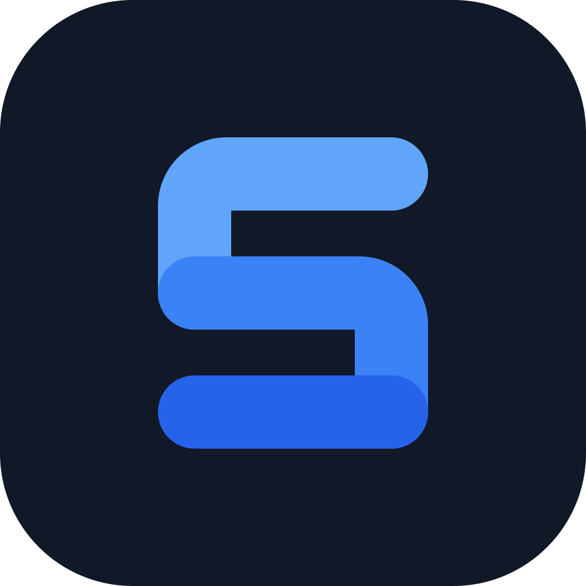

<div align="center">



# sThree Browser

### A safe S3 browser for the desktop and the web

[](https://www.typescriptlang.org/)
[](https://react.dev/)
[](https://nextjs.org/)
[](https://tauri.app/)
[](https://nodejs.org/)
[](#web-version-docker)

Browse AWS S3, Cloudflare R2, MinIO, and any S3-compatible storage. Your keys stay encrypted on your device, and every request goes straight from your device to your bucket.

[Report a bug](https://github.com/MohamadTahir/sThree-Browser/issues) · [Request a feature](https://github.com/MohamadTahir/sThree-Browser/issues)

</div>

---

## Features

**Browse and manage**
- Many connections across providers, organised into colour-coded groups.
- Folder browsing with breadcrumbs, a sortable list (name, size, modified) and pagination.
- Folder sizes and last-modified dates, computed in the background.
- Quick actions on every row: download, share link, copy key or path, delete.
- Keyboard navigation: arrow keys move through the list, Backspace goes up a folder.

**Files**
- Upload by picker or drag and drop. Large files upload in parallel parts, and a failed or cancelled upload cleans up after itself.
- A warning before an upload overwrites existing files.
- Downloads go straight to disk; nothing is buffered in the app.
- Share links that expire after 15 minutes, 1 hour, 1 day or 7 days.
- Previews for images, video, audio and text/code. PDFs open in a new tab.
- Create folders. Delete folders with everything in them, after a count and a type-to-confirm.

**Comfort**
- "Test connection" when adding a bucket, and plain-language errors that say what to fix.
- System, light and dark themes.
- The same app on macOS, Windows, Linux and the web.

---

## Security model

- **Encrypted vault.** Connections, credentials and groups are stored as one AES-256-GCM ciphertext. The key is derived from your master password with scrypt (N=2¹⁷, r=8, p=1) and held in memory only as a non-extractable key. Nothing about your buckets is stored in plain text.
- **No middleman.** Every S3 request is signed on your device and sent straight to your storage endpoint: by the browser on the web, and by the Tauri HTTP plugin on desktop. The server that hosts the web version never sees your keys.
- **Auto-lock.** The vault locks after 15 minutes without input (a running upload counts as activity), or when you press **Lock**. Locking clears every decrypted secret from the page and aborts uploads first, then reloads, so it can't be left half-open.
- **Multiple tabs.** A tab only saves if the stored vault is still the one it unlocked. After a password change or reset in another tab, every other open tab locks itself instead of restoring the old password or deleted data; ordinary setting changes sync across tabs.
- **Hardened web build.** Strict Content-Security-Policy, `Referrer-Policy: no-referrer` (so share links never leak), `X-Frame-Options: DENY`, and no `X-Powered-By`. S3 responses bypass the browser cache.
- **No tracking.** No analytics and no telemetry.
- **Upgrading from 0.0.x:** existing data is migrated to the new vault format the first time you unlock.

There is no password recovery. If you forget the master password, reset the vault and add your connections again. Your buckets are not affected.

---

## Getting started

### Desktop app

There are no prebuilt installers yet, so build the desktop app from source (see [Development](#development)):

```bash
make tauri-build
```

The installers end up in `src-tauri/target/release/bundle/`. The desktop app talks to S3 through Rust, so buckets need no CORS setup.

### Web version (Docker)

```bash
docker run -d -p 3000:3000 --name sthree-browser ghcr.io/mohamadtahir/sthree-browser:latest
```

Open http://localhost:3000.

The image is a static site served by [static-web-server](https://static-web-server.net), a single Rust binary on a scratch base (about 13 MB in all). There is no application server: the container only delivers the app's files, runs as a non-root user, and never sees a credential or an S3 request. `GET /health` returns 200 for orchestrator probes (the image itself defines no Docker health check).

#### Hosting it elsewhere

`make build` writes the whole app to `out/` as plain static files, so any static host works: static-web-server, nginx, Caddy, Cloudflare Pages, Netlify, or S3 with CloudFront. Serve it over HTTPS, and configure the security headers listed in [`sws.toml`](sws.toml) on that host, because a static host can't send them otherwise. Hosts that can't set custom headers (such as plain GitHub Pages) work, but without that protection.

#### Bucket CORS (web only)

On the web, your browser talks to S3 directly, so each bucket must allow the site's origin. If a bucket isn't set up, the app shows the exact rule to copy. It looks like this; replace the origin with where you host sThree Browser:

```json
[
  {
    "AllowedOrigins": ["http://localhost:3000"],
    "AllowedMethods": ["GET", "PUT", "POST", "DELETE", "HEAD"],
    "AllowedHeaders": ["*"],
    "ExposeHeaders": ["ETag", "Content-Length", "Content-Type", "Last-Modified"],
    "MaxAgeSeconds": 3600
  }
]
```

`ETag` must be exposed for multipart uploads to complete.

### First run

1. Create a master password (at least 12 characters). It encrypts everything the app stores.
2. Open **Credentials** in the sidebar and add an access key ID and secret access key.
3. Click **+** next to **Connections** and fill in the bucket, region and, for anything other than AWS, the endpoint (for example `https://<account>.r2.cloudflarestorage.com`). Turn on **Use path-style URLs** for MinIO and similar services.
4. Press **Test connection**, then **Add connection**.

---

## Development

### Prerequisites

- Node.js 26+ and pnpm 10 (`.nvmrc` pins Node 26)
- Rust (latest stable) and the [Tauri prerequisites](https://v2.tauri.app/start/prerequisites/), for the desktop app
- Docker, for the container and the local test server

### Setup

```bash
git clone https://github.com/MohamadTahir/sThree-Browser.git
cd sThree-Browser
make install
```

### Common tasks

Run `make` to list all targets.

| Command | What it does |
| :--- | :--- |
| `make dev` | Web app in dev mode at http://localhost:3000 |
| `make tauri-dev` | Desktop app with hot reload |
| `make typecheck` | Type-check the project |
| `make check` | Type-check, build, and compile-check the desktop app |
| `make build` | Production build: the static site in `out/` (shared by web and desktop) |
| `make serve` | Build, then serve `out/` with the production static-web-server config (`PORT=3000`) |
| `make tauri-build` | Desktop installers |
| `make docker-build` / `make docker-run` | Build or run the web image (`PORT=3000`) |
| `make minio` / `make minio-stop` | Throwaway local MinIO for testing on http://localhost:19000 |
| `make clean` | Delete build output |

### Testing against local storage

`make minio` starts a disposable MinIO and prints its endpoint and access key. It also prints a command that creates a test bucket. In the app, add a connection with endpoint `http://localhost:19000` and path-style URLs turned on. `make minio-stop` stops it and discards its data.

### Project layout

```
src/
  app/            Next.js entry (page, layout)
  components/     UI: shell, sidebar, explorer, dialogs, ui/ primitives
  context/        Vault state, auto-lock, config updates
  services/       vault.ts (encryption), s3Service.ts (all S3 calls)
  lib/            Tauri bridge, theme, helpers
src-tauri/        Desktop shell (Rust, Tauri 2)
sws.toml          Production web server config (static-web-server) and security headers
public/           Logo, favicon, pre-paint theme script
DESIGN.md         Design system: tokens, components, rules
PRODUCT.md        Product context: users, purpose, principles
```

### Releases

Pushing a tag like `v1.2.3` builds a multi-arch image (amd64 and arm64) and publishes it to `ghcr.io/mohamadtahir/sthree-browser`, with an SBOM and a signed build-provenance attestation.

---

## Contributing

Contributions are welcome:

1. Fork the repository.
2. Create a feature branch: `git checkout -b feature/your-change`.
3. Run `make check` before you push.
4. Open a pull request.

## License

MIT.

---

<div align="center">
  <sub>Made by Mohamad Tahir</sub>
</div>
